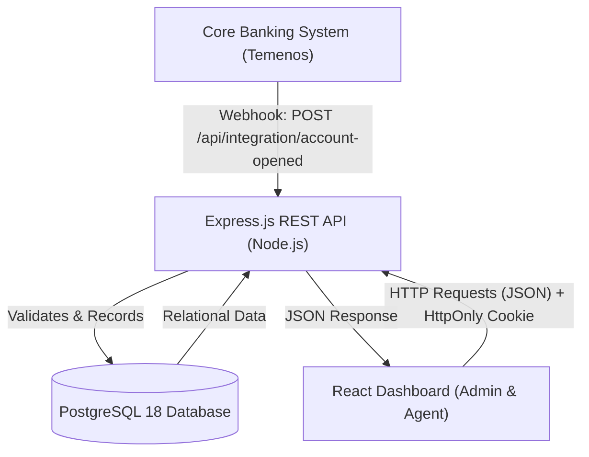
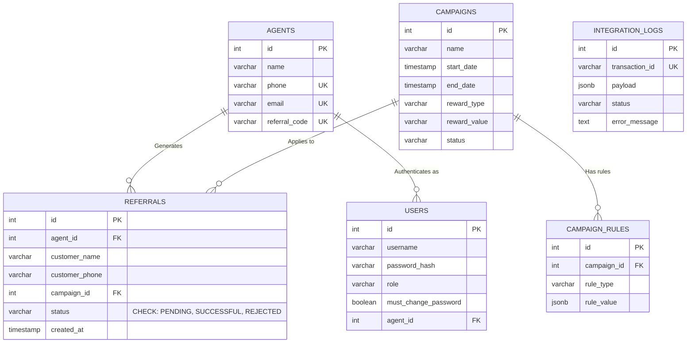
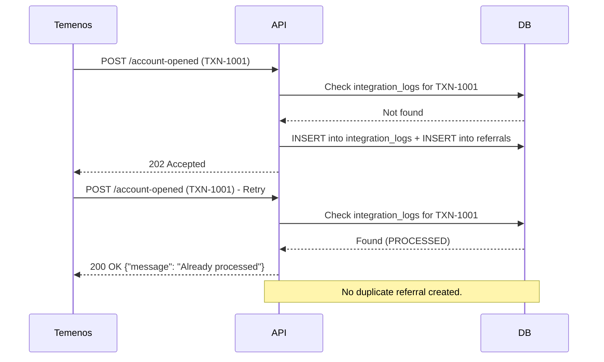

# Nib International Bank: Referral Management System (V2)

> A secure, event-driven referral tracking and campaign management system designed to integrate with Nib Bank's Core Banking System (Temenos). Built as a university internship mini-project.

**Project Context:** University Internship Mini-Project  
**Institution:** Nib International Bank (Mexico Branch, Addis Ababa)  
**Author:** Feysal Jeylan  
**Date:** October 2026

---

## 📖 Executive Summary

Manual referral tracking is prone to data duplication, delayed reward processing, and internal fraud. This system solves that by acting as an **event-driven listener** for the bank's Core Banking System (Temenos).

Instead of registering customers manually, the system receives webhooks when a customer opens an account using a referral code. It then validates the code, checks active marketing campaigns, and automatically tracks the agent's progress towards reward tiers.

---

## 🏗️ System Architecture

The application follows a decoupled, three-tier architecture, plus an external integration layer.



---

## 🗄️ Database Schema (Entity-Relationship Diagram)

The database is highly normalized to ensure ACID compliance.



---

## 🔄 Core Banking Integration & Idempotency

### The Flow

1. A customer opens an account in Temenos and provides an agent's `referral_code`.
2. Temenos fires a webhook to `POST /api/integration/account-opened`.
3. The system validates the code, finds the active campaign, and records the referral.

### Idempotency (The Safety Net)


If Temenos sends the same `transaction_id` twice due to network retries, the system **must not** double-credit the agent.



---
---

## ⚙️ V6 Rule Engine (Campaign Qualification)

Banks don't just reward agents for any referral—they reward for **qualified** referrals. The V6 Rule Engine enforces this.

### How it works:
1. Admin creates a campaign and attaches rules (e.g., `MIN_DEPOSIT GREATER_THAN 5000`).
2. Admin activates the campaign.
3. Temenos sends a webhook with customer data (`deposit_amount`, `account_type`).
4. The `services/ruleEngine.js` evaluates every rule in the campaign.
5. If any rule fails, the referral is **rejected** and the exact reason is logged in `integration_logs`.
6. If all rules pass, the referral is created as `PENDING` for Admin approval.

### Supported Operators:
`GREATER_THAN`, `LESS_THAN`, `EQUALS`, `GREATER_THAN_OR_EQUAL`, `LESS_THAN_OR_EQUAL`, `NOT_EQUALS`

### Example Rejection Log:
```json
{
  "transaction_id": "TXN-RULE-FAIL",
  "disqualified": true,
  "reason": "MIN_DEPOSIT: deposit_amount (1000) must be GREATER_THAN 5000"
}

## 🛡️ Enterprise Security Architecture

Because this operates in a banking context, security is non-negotiable:

- **Stateless Auth (JWT & HttpOnly Cookies):** JWTs are stored in `HttpOnly`, `SameSite=Strict` cookies, preventing XSS attacks.
- **Forced Password Change:** New agents receive a temporary password, simulated via email. They are forced to create a new one on first login.
- **Role-Based Access Control (RBAC):** Middleware strictly enforces roles. Agents can only view their own stats. Only Admins can activate campaigns or view integration logs.
- **SQL Injection Prevention:** 100% of queries use parameterized inputs (`$1`, `$2`).
- **Campaign Rules (JSONB):** Flexible rules, such as `MIN_DEPOSIT`, are stored as JSONB, allowing schema changes without migrations.

---

## 💻 Running the Project Locally

### Prerequisites

- Node.js (v18+)
- PostgreSQL (v18+) running on port `5432`

### 1. Database Setup

Run the following commands from the project root, assuming the database scripts are located in `referral-api`.

```bash
psql -U postgres -c "CREATE DATABASE referral_db;"

cd referral-api

psql -U postgres -d referral_db -f schema.sql
psql -U postgres -d referral_db -f schema_auth.sql
psql -U postgres -d referral_db -f schema_v3_password.sql
psql -U postgres -d referral_db -f schema_v4_campaigns.sql
```

### 2. Backend Setup

Navigate to the backend directory and install the dependencies.

```bash
cd referral-api
npm install
```

Create a `.env` file in the `referral-api` directory with the following configuration.

```env
PORT=3000
DB_HOST=localhost
DB_PORT=5432
DB_USER=postgres
DB_PASSWORD=your_password
DB_NAME=referral_db
JWT_SECRET=your_super_secret_key
```

#### Seed the Default Admin

```bash
node seed_admin.js
```

#### Start the Backend

```bash
npm run dev
```

### 3. Frontend Setup

Open a new terminal and run the following commands.

```bash
cd referral-web
npm install
npm run dev
```

---

## 🔑 System Access (Demo Credentials)

- **Admin URL:** `http://localhost:5173`
- **Username:** `admin`
- **Password:** `admin123`
