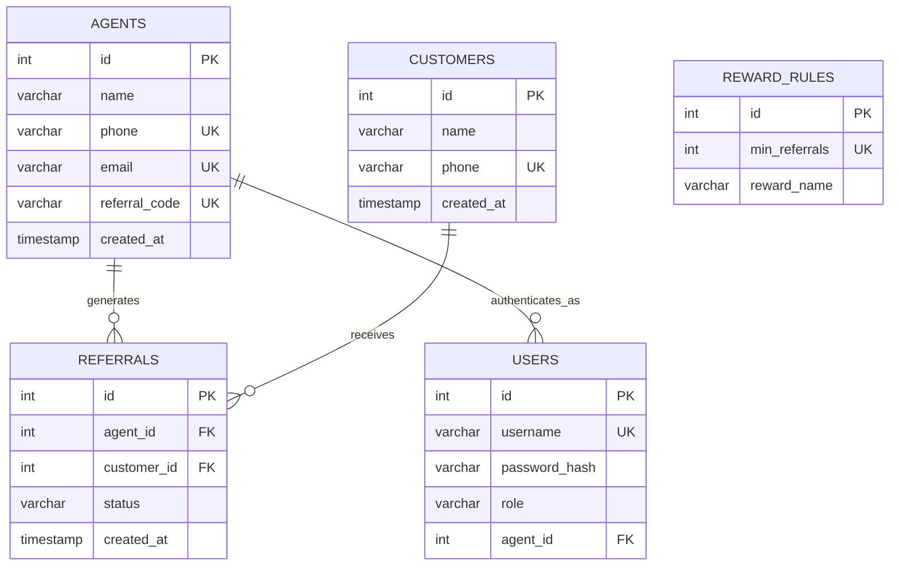
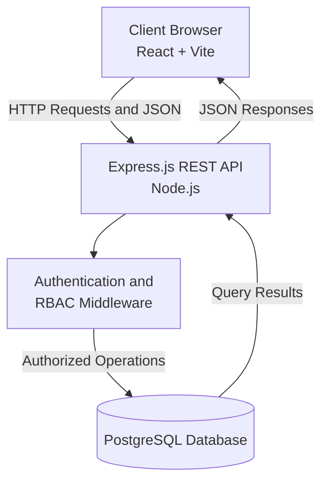
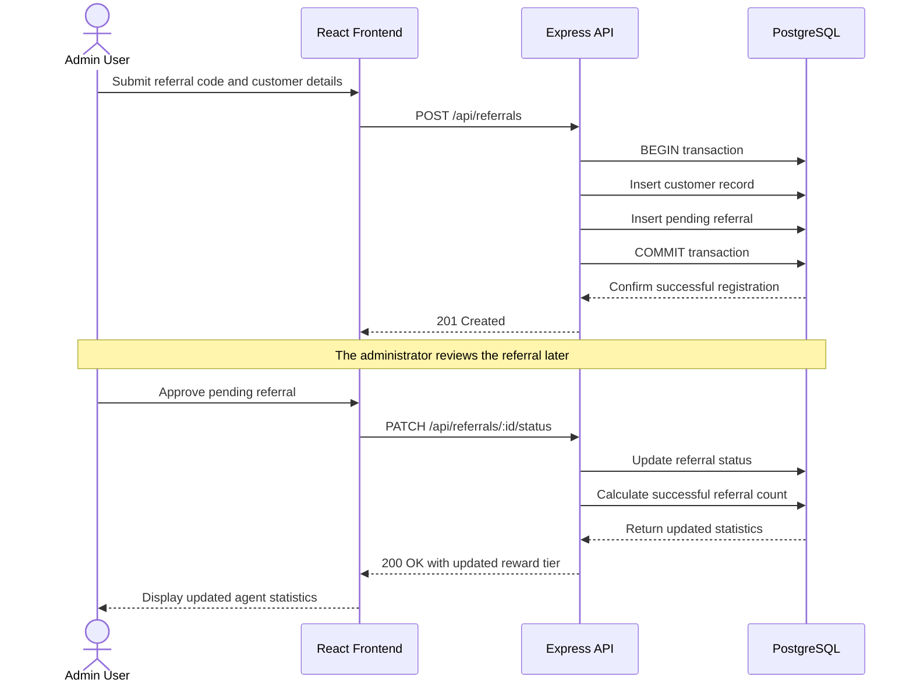

# Nib International Bank Referral Management System

A secure, full-stack enterprise application designed to automate agent referral tracking, enforce role-based access control, and calculate customer acquisition rewards based on configurable business rules.

## Project Overview

- **Institution:** Nib International Bank, Mexico Branch, Addis Ababa
- **Project Type:** University Internship Mini-Project
- **Author:** Feysal Jeylan
- **Date:** October 2026
- **Tech Stack:** React, Vite, Node.js, Express.js, PostgreSQL

## Database Schema

The database uses relational tables, foreign keys, unique constraints, and check constraints to maintain data integrity.



## Executive Summary

Manual referral tracking is vulnerable to duplicate records, delayed reward processing, and unauthorized changes.

This system provides a centralized web portal where authorized users manage agents, register customers through referral codes, review referrals, and track agent performance.

The application calculates reward tiers using configurable database rules, such as Bronze, Silver, and Gold, based on the number of successful referrals.

## System Architecture

The application follows a three-tier architecture that separates the frontend, backend API, and database.



## Core Business Workflow

The following sequence illustrates referral registration, approval, and reward calculation.



## Security Architecture

Security and data integrity are important design requirements for this banking-related application.

- **Authentication:** JSON Web Tokens (JWT) are transmitted through `HttpOnly` cookies with appropriate `SameSite` settings.
- **Password Hashing:** Passwords are hashed using `bcrypt` with a configured cost factor of 12. Plain-text passwords are never stored.
- **Role-Based Access Control:** Middleware restricts API operations according to user roles. Administrators manage agents and referrals, while agents access only their authorized information.
- **SQL Injection Prevention:** Parameterized SQL queries protect database operations from SQL injection.
- **ACID Transactions:** Customer and referral creation use database transactions to prevent incomplete records.
- **HTTP Security:** Helmet.js sets security-related HTTP headers.
- **Cross-Origin Resource Sharing:** CORS policies restrict requests to approved origins.

## Running the Project Locally

### Prerequisites

- Node.js and npm
- PostgreSQL
- Configured environment variables
- Project dependencies installed

### 1. Start the Backend API

Open a terminal and run:

```bash
cd referral-api
npm install
npm run dev
```

The backend API runs at `http://localhost:3000`, assuming the configured development port is 3000.

### 2. Start the Frontend

Open a second terminal and run:

```bash
cd referral-web
npm install
npm run dev
```

The frontend runs at `http://localhost:5173`, assuming the default Vite development port.

### 3. Access the Application

Open the frontend URL in your browser:

`http://localhost:5173`

### Demo Credentials

Use the following credentials only if the corresponding demo account has been configured in your local database.

- **Username:** `admin`
- **Password:** `admin123`

## Production Roadmap

The following features are potential future enhancements.

1. **Core Banking Integration:** Integrate with approved banking systems to verify customer qualification events.
2. **Maker-Checker Workflow:** Require independent authorization for reward approvals and financial payouts.
3. **Single Sign-On:** Integrate with the bank's approved identity provider.
4. **Audit Logging:** Maintain tamper-resistant records of important actions and administrative changes.
5. **Configurable Reward Rules:** Allow authorized administrators to manage reward thresholds through controlled interfaces.
6. **Automated Testing:** Add unit, integration, and end-to-end tests for critical business workflows.

## Disclaimer

This project is an internship mini-project developed for learning and demonstration purposes. It is not an official banking production system and should not process real customer data or financial transactions without formal security review, authorization, and compliance approval.
